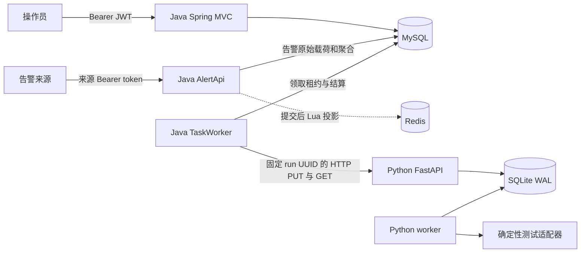

# OpsPilot 系统架构

Java 负责用户、资产、工单、告警、分诊候选、任务和审计。MySQL 的复合主键支持租户隔离。工单版本限制可接受的状态更新，任务租约令牌限制哪个 worker 能提交结果。Redis Lua 在数据库事务提交后投影窗口计数，Redis 断开时 MySQL 继续承担权威状态。

Python 通过版本化 HTTP API 与 Java 协作。SQLite 保存 run、请求摘要、租约和状态事件。Java 按稳定 UUID 重放丢响应请求。可能已执行的外部模型调用发生不确定错误时，Python 记录 UNKNOWN_OUTCOME。

Java 与 Python 由本机进程运行。Compose 维护 MySQL 和可选 `alert-cache` Redis。诊断任务由 MySQL 队列调度。下一阶段的 RocketMQ、遥测、排序算法、审批与前端见 [项目状态](PROJECT_STATUS.md)。

[调用图](CALL_FLOW.md) · [数据库设计](DATABASE_DESIGN.md) · [接口契约](API_CONTRACT.md) · [架构决定](docs/adr/0001-module-and-storage-boundary.md)
