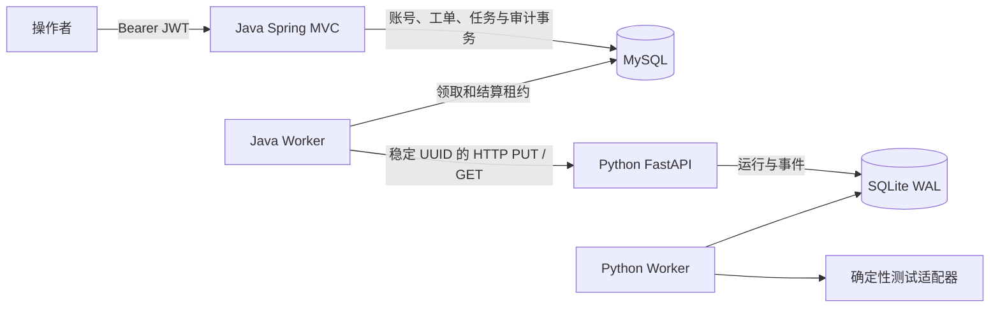

# OpsPilot Phase 1 架构

Java 公共接口只读取当前认证租户。资产复合主键约束工单引用的服务归属。Python 专用服务令牌代表 Java 边界，Python 返回诊断结果和运行状态，工单变更由 Java 负责。

HTTP 无响应时 Java 按同一 UUID 重放幂等 PUT，之后轮询该 run。Java 工单业务写依赖 MySQL。Agent 不可达时工单读写仍可继续。应用内部队列每个调度周期领取一项。
