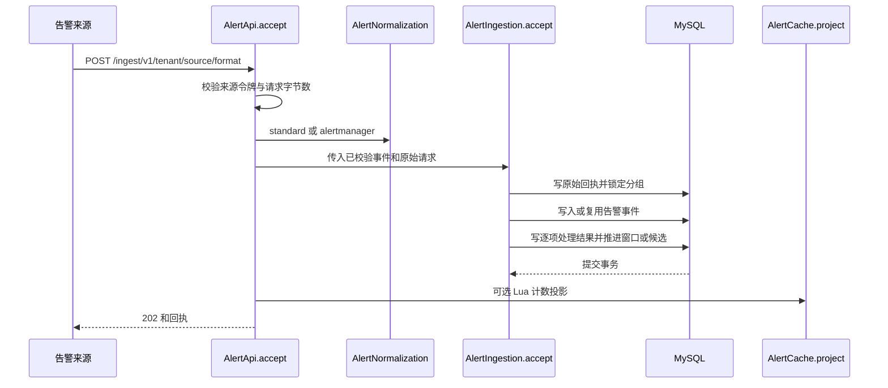
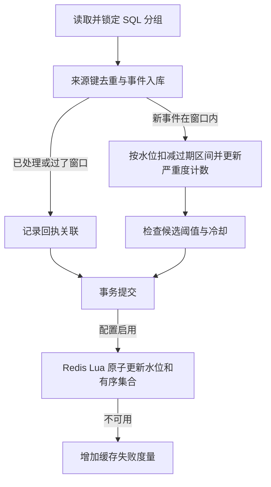
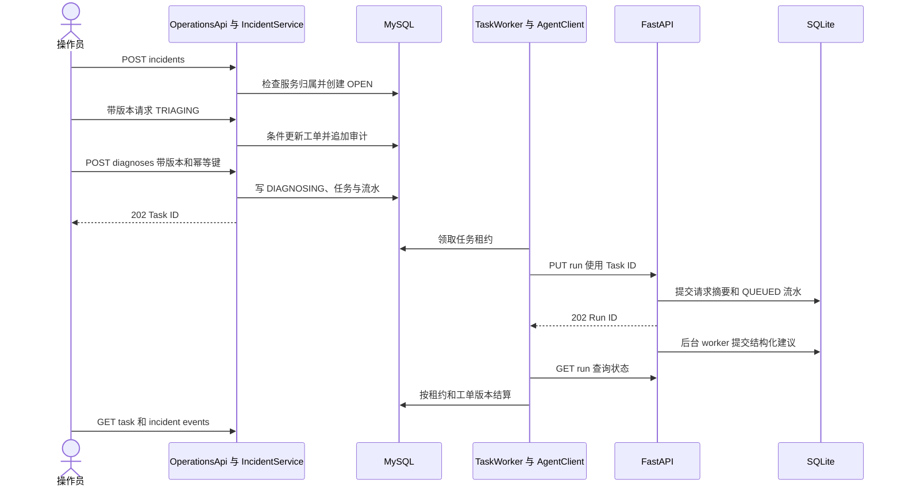
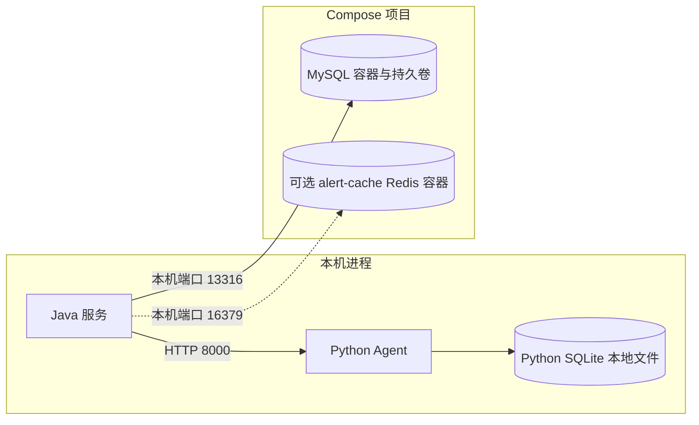

# 实际调用流程

## 告警接收

## MySQL 聚合与 Redis 投影

事件时间窗口及 SQL 查询边界见 [告警设计](docs/alerts.md)。

## 故障工单与诊断

第一次 PUT 响应丢失时，后续请求仍携带原租户、UUID 和请求体。取消请求根据 Java 任务状态在本地确认或发送 Python 取消端点。Python 确认后落库终态。[工单状态机](INCIDENT_STATE_MACHINE.md) · [任务恢复机制](AGENT_TASK_ENGINE.md)

## Docker 部署关系

## 后续流程

| 需求 | 状态 | 当前可追踪入口 |
| --- | --- | --- |
| RocketMQ、Outbox 与 Inbox | NOT_IMPLEMENTED | TaskWorker 当前从 MySQL 调度 |
| LangGraph 工作流及 MCP | NOT_IMPLEMENTED | Python work_once 调用固定 provider |
| 根因排序算法 | NOT_IMPLEMENTED | Report 返回证据不足和待检查项 |
| 审批、处置与恢复验证 | NOT_IMPLEMENTED | 状态枚举包含后续转换，公开入口只执行目前实现的流程 |
