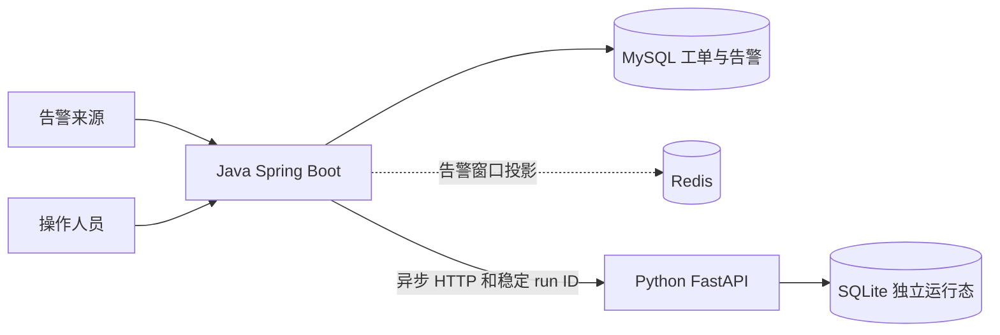

# OpsPilot

OpsPilot 是一个验证到 Phase 2 的 AIOps 与故障响应工程。它把告警接收、故障工单和异步诊断串在一起，验证告警重放、HTTP 响应丢失、服务重启和缓存不可用时的业务一致性。

## 已实现的业务流程

| 流程 | 当前行为 |
| --- | --- |
| 告警接入 | 接收标准事件和 Alertmanager v4 格式，校验来源，留存原始载荷和逐项回执 |
| 告警聚合 | MySQL 去重、事件时间窗口与候选冷却。Redis Lua 提供可降级的计数投影 |
| 故障工单 | Java 管理 JWT、RBAC、服务资产、租户隔离、状态版本与审计 |
| 诊断任务 | Java 使用数据库队列、租约及稳定任务 ID。Python 使用独立 SQLite 记录异步运行和取消 |
| 调查结果 | 默认 DETERMINISTIC_TEST 返回待调查建议。Java 按工单版本接收结果并进入人工复核 |

收到分诊候选后，操作员可以创建工单、分诊、提交诊断，再读取任务和增量事件。Java 保存权威业务状态，Python 保存自己的运行态。



## 技术、目录与启动

Java 使用 JDK 21、Maven、Spring Boot 3.5、Spring Security、MyBatis、Flyway、Micrometer 和 JUnit。Python 使用 3.13.5、FastAPI、Pydantic、httpx、SQLite WAL 和 pytest。Docker Compose 固定 MySQL 8.4.8、Redis 7.4.8 镜像摘要。

`backend-java/` 和 `agent-python/` 用于业务与诊断，`scripts/` 为启动及验收入口，`infra/` 存储 Compose 覆盖配置。文档位于根目录及 `docs/`，原始证据位于 `artifacts/`。

先安装 JDK 21、Maven、Python 3.13 和支持 Compose 的 Docker。设置本地数据库密码后执行 `docker compose --profile alert-cache up -d --wait mysql redis`。配置本机环境后使用 `scripts/start-local.ps1` 或 `bash scripts/start-local.sh` 启动 Java 和 Python。

[目录树](PROJECT_TREE.txt) · [结构说明](PROJECT_STRUCTURE.md) · [架构](ARCHITECTURE.md) · [Windows 指南](WINDOWS_QUICKSTART.md) · [Linux 指南](docs/linux-quickstart.md) · [配置模板](.env.example)

## 测试与实验

```sh
mvn -B -ntp -f backend-java/pom.xml verify
python -m pip install -r agent-python/requirements.lock
python -m pytest agent-python
```

在数据库和 Redis 就绪后，运行 `scripts/verify_phase1.py` 和 `scripts/verify_phase2.py`。端到端验收覆盖任务响应丢失、重启恢复、缓存不可用和并发重放。

| 项目 | 状态 |
| --- | --- |
| Phase 1、Phase 2 功能验收 | VERIFIED |
| GitHub Actions | [远程运行及发布验收](GITHUB_PUBLISH_REPORT.md) |
| QPS、延迟分位数、压力与容量 | NOT_RUN |
| RCA 准确率、Agent 成本、真实模型调用 | NOT_RUN |
| Vue 工作台与界面截图 | NOT_IMPLEMENTED |

[测试报告和原始证据](TEST_REPORT.md) · [演示步骤](DEMO_GUIDE.md)

## 边界与开发计划

当前部署为本机环境，服务默认监听回环地址，凭证来自环境配置。Flyway 在 MySQL 8.4 发出兼容性提醒，空库迁移与重启后校验已通过。Docker 默认地址池耗尽时可以使用仓库中的 IPAM 覆盖配置。后续阶段包括 RocketMQ 与 Outbox/Inbox、真实遥测、RCA 排序、LangGraph、审批与 Vue。

[当前状态](PROJECT_STATUS.md) · [开发计划](DEVELOPMENT_PLAN.md) · [安全核验](SECURITY_AUDIT.md) · [授权状态](LICENSE)

## 源码学习

从 [ChatGPT 交接](CHATGPT_HANDOFF.md) 开始，再阅读 [Java 方法](METHOD_REFERENCE.md)、[Python 函数](FUNCTION_REFERENCE.md)、[接口契约](API_CONTRACT.md)、[数据库设计](DATABASE_DESIGN.md) 和 [调用图](CALL_FLOW.md)。[面试指南](INTERVIEW_GUIDE.md) 与 [已验证项目经历](VERIFIED_RESUME_HIGHLIGHTS.md) 汇总可复现成果。
